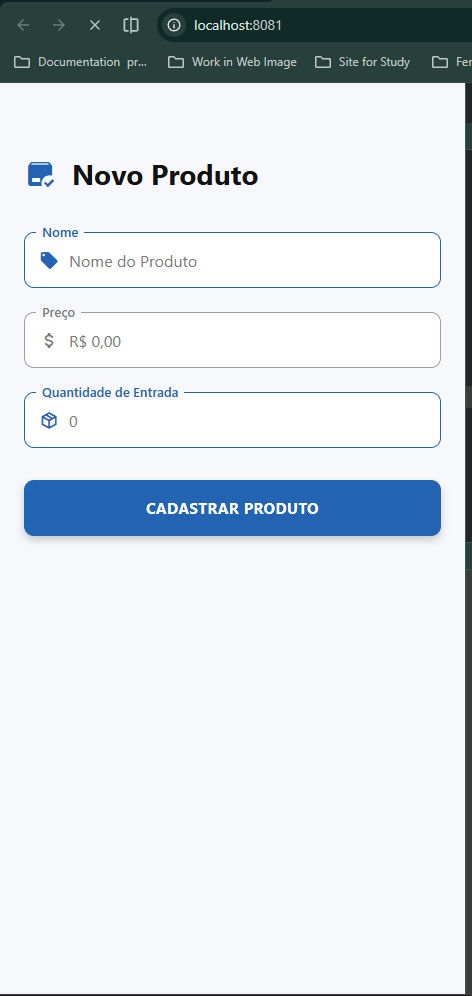

# 📦 App Produto — Cadastro de Produtos no Estoque

> **Projeto acadêmico** — Desenvolvimento Mobile (React Native / Expo)

Aplicativo comercial que implementa a interface de **cadastro de um novo produto** para
registro da entrada de itens no estoque de uma empresa. A tela reproduz o fluxo de
preenchimento de um formulário corporativo (nome, preço e quantidade) e simula o envio
da submissão com um alerta nativo de sucesso.

---

## 🔍 Objetivo

Desenvolver a interface de cadastro de um aplicativo comercial capaz de registrar a
**entrada de itens no estoque de uma empresa**, aplicando conceitos fundamentais de
React Native: componentes, `StyleSheet`, design tokens, ícones vetoriais e interação de
usuário com `Alert`.

---

## ✨ Funcionalidades

- **Cabeçalho corporativo** com ícone e título **"Novo Produto"**.
- **Formulário de entrada de dados** com três campos no padrão *Outlined* (label flutuante
  sobre o contorno, com cantos arredondados e ícone interno):
  - **Nome** — ícone de etiqueta (tag), placeholder *"Nome do Produto"*, estado ativo.
  - **Preço** — ícone de cifrão, placeholder *"R$ 0,00"*, estado inativo.
  - **Quantidade de Entrada** — ícone de caixa/pacote, placeholder *"0"*, estado ativo.
- **Botão de ação** na cor primária do sistema, com sombra e texto **"CADASTRAR PRODUTO"**.
- **Simulação de login/submissão**: ao tocar no botão, um `Alert.alert()` exibe
  *"Sucesso — Ação validada com sucesso!"*.
- Design responsivo e visual fiel a um aplicativo comercial real.

---

## 🛠️ Tecnologias

| Tecnologia | Função |
|---|---|
| [React Native](https://reactnative.dev/) + [Expo SDK 54](https://expo.dev) | Base do aplicativo |
| [Expo Router](https://docs.expo.dev/router/introduction/) | Navegação baseada em arquivos |
| [@expo/vector-icons](https://docs.expo.dev/guides/icons/) | Ícones vetoriais (MaterialCommunityIcons) |
| [TypeScript](https://www.typescriptlang.org/) | Tipagem do código-fonte |
| [ESLint](https://eslint.org/) | Padrão de código e linting |

---

## 📁 Estrutura do Projeto

```
app-produto/
├── src/
│   ├── app/                 # Rotas do Expo Router
│   │   ├── _layout.tsx      # Layout raiz (Stack)
│   │   └── index.tsx        # Tela de cadastro de produto
│   └── constants/
│       └── theme.ts         # Temas / design tokens (cores e fontes)
├── assets/                  # Imagens e ícones do aplicativo
├── app.json                 # Configuração do Expo
├── package.json             # Dependências e scripts
├── eslint.config.js         # Configuração do ESLint
└── tsconfig.json            # Configuração do TypeScript
```

---

## 🚀 Como Executar

### Pré-requisitos

- [Node.js](https://nodejs.org/) (LTS)
- [Expo Go](https://expo.dev/go) instalado no celular **ou** um simulador/emulador configurado
- Gerenciador de pacotes: `npm` (já incluído com o Node.js)

### Passo a passo

```bash
# 1. Instalar as dependências
npm install

# 2. Iniciar o servidor de desenvolvimento
npx expo start --clear

# 3. Escanear o QR Code com o Expo Go (Android/iOS)
#    ou pressione "w" para abrir no navegador
```

### Scripts úteis

| Comando | Descrição |
|---|---|
| `npm start` | Inicia o Expo |
| `npm run android` | Inicia no emulador Android |
| `npm run ios` | Inicia no simulador iOS |
| `npm run web` | Inicia no navegador |
| `npm run lint` | Executa o ESLint |

---

## 📸 Comprovante Visual

Print da tela rodando no **Expo Go**:

<div align="center">
  
</div>

---

## 💻 Interface Implementada

<div align="center">

| Elemento | Detalhe |
|---|---|
| Cabeçalho | Ícone `package-check` + título **"Novo Produto"** em negrito |
| Campo 1 | **Nome** — ícone de etiqueta, borda ativa (primária) |
| Campo 2 | **Preço** — ícone de cifrão, borda inativa (cinza) |
| Campo 3 | **Quantidade de Entrada** — ícone de pacote, borda ativa (primária) |
| Botão | **CADASTRAR PRODUTO** — primário, com sombra e `Alert` de sucesso |

</div>

---

## 🎓 Autoria

Projeto desenvolvido como parte das atividades da disciplina de **Desenvolvimento Mobile**,
com foco em interface de aplicações comerciais em React Native.

---

## 📄 Licença

Este projeto é de uso educacional e está licenciado sob a
[Licença MIT](./LICENSE).