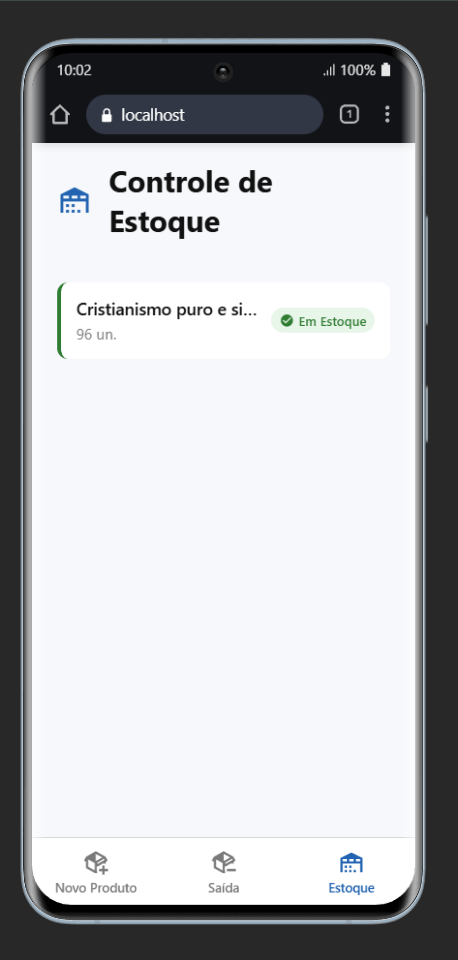

# 📦 App Produto — Controle de Estoque

> **Projeto acadêmico** — Desenvolvimento Mobile (React Native / Expo)

Aplicativo comercial para **cadastro de produtos**, **registro de saídas** e
**consulta do estoque** de uma empresa. Os dados ficam salvos no próprio
dispositivo, então o que é cadastrado continua disponível depois de fechar o app.

---

## 📋 Sobre o projeto

O app simula o fluxo básico de um sistema de estoque: o operador cadastra um
produto com preço e quantidade inicial, retira itens informando o motivo e
acompanha a posição atual do est](image.png)oque em uma lista com alerta de estoque baixo.

A navegação é feita por uma **barra de abas inferior** com três telas:

| Aba | Tela | Função |
|---|---|---|
| **Novo Produto** | Cadastro | Registra um produto no estoque |
| **Saída** | Saída de Produtos | Retira unidades de um produto |
| **Estoque** | Controle de Estoque | Lista os produtos e o status de cada um |

---

## ✨ Funcionalidades

### Novo Produto

- Formulário com **Nome**, **Preço**, **Quantidade de Entrada** e **Estoque Mínimo**.
- Campos no padrão *Outlined*, com **label flutuante**, ícone interno e placeholder.
- O label fica sobre a borda superior e muda para azul quando o campo está ativo ou focado.
- Aceita preço no formato brasileiro (`10,50`) e no formato com ponto (`10.50`).
- Valida os dados antes de salvar e exibe um alerta de sucesso ou de erro.
- Todos os campos são limpos após o cadastro.

### Saída de Produtos

- Seleção do produto em uma **lista modal**, que mostra a quantidade disponível.
- Informe a quantidade de saída e o **motivo**: Venda, Avarias ou Uso Interno.
- Bloqueia quantidades maiores do que o estoque disponível.
- Atualiza o estoque na hora e registra a movimentação com data e hora.
- A lista de produtos é recarregada sempre que a tela recebe foco.

### Controle de Estoque

- Lista com nome, quantidade atual e **badge de status**.
- Dois estados: **Em Estoque** (verde) e **Estoque Baixo** (vermelho).
- Exibe uma mensagem quando nenhum produto foi cadastrado ainda.

### Persistência e interface

- Dados salvos com **AsyncStorage**, no dispositivo, sem backend.
- Operações de leitura e escrita enfileiradas para evitar condições de corrida.
- Layout responsivo, limitado a **480 pt** e centralizado em telas largas.
- Barra de abas com altura fixa somada à **safe area** (notch e barra inferior).
- No navegador, o contorno padrão de foco dos inputs é removido e o destaque
  passa a ser a borda azul do próprio componente.

---

## 🧠 Regras de negócio

- **Preço** deve ser um número maior que zero.
- **Quantidade de entrada** e **estoque mínimo** devem ser inteiros não negativos.
- **Saída** deve ser um inteiro maior que zero e menor ou igual ao saldo atual.
- Um produto é considerado em **estoque baixo** quando
  `quantidade <= estoqueMinimo`.
- Cada saída gera uma movimentação com produto, quantidade, motivo e data.

As validações de formulário ficam em `src/models/produto.ts`; as regras que
dependem do estoque salvo ficam em `src/services/produtos.ts`.

---

## 🛠️ Tecnologias

| Tecnologia | Função |
|---|---|
| [React Native](https://reactnative.dev/) + [Expo SDK 54](https://docs.expo.dev/versions/v54.0.0/) | Base do aplicativo |
| [Expo Router](https://docs.expo.dev/router/introduction/) | Navegação baseada em arquivos |
| [React Navigation](https://reactnavigation.org/) | Abas inferiores |
| [AsyncStorage](https://react-native-async-storage.github.io/async-storage/) | Persistência local dos dados |
| [@expo/vector-icons](https://docs.expo.dev/guides/icons/) | Ícones vetoriais (MaterialCommunityIcons) |
| [react-native-safe-area-context](https://docs.expo.dev/develop/user-interface/safe-areas/) | Safe area do cabeçalho e das abas |
| [TypeScript](https://www.typescriptlang.org/) | Tipagem do código-fonte (modo `strict`) |
| [ESLint](https://eslint.org/) | Padrão de código e linting |

---

## 📁 Estrutura do Projeto

```
app-produto/
├── src/
│   ├── app/                        # Rotas do Expo Router
│   │   ├── _layout.tsx             # Layout raiz (Stack)
│   │   └── (tabs)/
│   │       ├── _layout.tsx         # Barra de abas inferior
│   │       ├── index.tsx           # Novo Produto
│   │       ├── saida.tsx           # Saída de Produtos
│   │       └── estoque.tsx         # Controle de Estoque
│   ├── components/
│   │   ├── novo-produto/
│   │   │   ├── product-form/       # ScrollView + botão de envio
│   │   │   └── product-fields/     # Campos do cadastro
│   │   ├── saida-produto/
│   │   │   ├── exit-form/          # Formulário de saída
│   │   │   └── product-selector/   # Seleção do produto
│   │   ├── controle-estoque/
│   │   │   ├── stock-list/         # Lista de produtos
│   │   │   └── stock-item/         # Cartão com status do produto
│   │   └── ui/                     # Componentes reutilizáveis
│   │       ├── badge/              # Etiqueta de status
│   │       ├── button/             # Botão primário
│   │       ├── field/              # Moldura do campo + label flutuante
│   │       ├── header/             # Cabeçalho das telas
│   │       ├── input/              # Campo de texto
│   │       ├── select/             # Campo de seleção com modal
│   │       ├── tab-button/         # Botão da barra de abas
│   │       └── types.ts            # Tipos compartilhados
│   ├── constants/
│   │   └── theme.ts                # Design tokens e largura máxima
│   ├── hooks/
│   │   └── use-produtos.ts         # Lista de produtos com recarga ao focar
│   ├── models/
│   │   └── produto.ts              # Tipos, validações e regras de status
│   └── services/
│       └── produtos.ts             # Persistência e operações no estoque
├── assets/images/                  # Ícones e splash screen
├── docs/screenshot.png             # Print do aplicativo
├── app.json                        # Configuração do Expo
├── eslint.config.js                # Configuração do ESLint
├── package.json                    # Dependências e scripts
└── tsconfig.json                   # Configuração do TypeScript
```

Cada componente mantém o padrão `index.tsx` + `style.ts` na mesma pasta. Os
imports usam o alias `@/*`, que aponta para `src/`.

---

## 🚀 Como Executar

### Pré-requisitos

- [Node.js](https://nodejs.org/) (LTS)
- [Expo Go](https://expo.dev/go) instalado no celular **ou** um simulador/emulador configurado
- Gerenciador de pacotes: `npm` (já incluído com o Node.js)

### Passo a passo

```bash
# 1. Instalar as dependências
npm install

# 2. Iniciar o servidor de desenvolvimento
npx expo start --clear

# 3. Escanear o QR Code com o Expo Go (Android/iOS)
#    ou pressione "w" para abrir no navegador
```

### Scripts úteis

| Comando | Descrição |
|---|---|
| `npm start` | Inicia o Expo |
| `npm run android` | Inicia no emulador Android |
| `npm run ios` | Inicia no simulador iOS |
| `npm run web` | Inicia no navegador |
| `npm run lint` | Executa o ESLint |

### Verificação

```bash
# Tipos do TypeScript
npx tsc --noEmit

# Build web estático
npx expo export --platform web
```

---

## 🗃️ Modelo de dados

Tudo é gravado em uma única chave do AsyncStorage:
`@app-produto:estoque`, com o formato `{ produtos, movimentacoes }`.

| Tipo | Campos principais |
|---|---|
| `Produto` | `id`, `nome`, `preco`, `quantidade`, `estoqueMinimo` |
| `SaidaProduto` | `produtoId`, `quantidade`, `motivo` |
| `Movimentacao` | `id`, `produtoNome`, `data` + dados da saída |

O histórico de movimentações já é gravado, mas ainda **não tem tela de consulta**.

---

## 🎨 Padrões de interface

As cores ficam centralizadas em `src/constants/theme.ts` e não são repetidas
nos componentes:

| Token | Valor | Uso |
|---|---|---|
| `primary` | `#2264B1` | Borda ativa, ícones e botão |
| `background` | `#F6F8FB` | Fundo das telas |
| `textDark` | `#111111` | Texto principal |
| `textMuted` | `#7A7A7A` | Labels inativos e placeholders |
| `success` | `#2E7D32` | Badge "Em Estoque" |
| `danger` | `#C62828` | Badge "Estoque Baixo" |

O conteúdo é limitado por `layout.larguraMaxima` (480 pt) e centralizado, para
não esticar em tablets e no navegador.

---

## 📸 Comprovante Visual

Print da tela de cadastro na versão inicial do projeto:

<div align="center">
  
</div>

> O print é anterior à navegação por abas. Para atualizá-lo, rode o app no
> Expo Go e gere uma nova captura em `docs/screenshot.png`.

---

## ⚠️ Limitações conhecidas

- No **navegador**, `Alert.alert` não exibe nada (é um no-op do `react-native-web`);
  no Android e no iOS os alertas funcionam normalmente.
- Ainda não há telas para **editar ou excluir** produtos, nem para consultar o
  histórico de movimentações.
- O projeto não possui testes automatizados no repositório; a verificação é
  feita com TypeScript, ESLint e build.

---

## 🎓 Autoria

Projeto desenvolvido como parte das atividades da disciplina de **Desenvolvimento Mobile**,
com foco em interface de aplicações comerciais em React Native.

---

## 📄 Licença

Projeto de uso educacional, sem fins comerciais.
